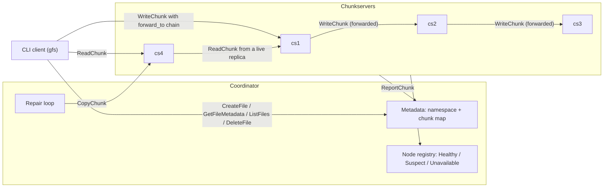
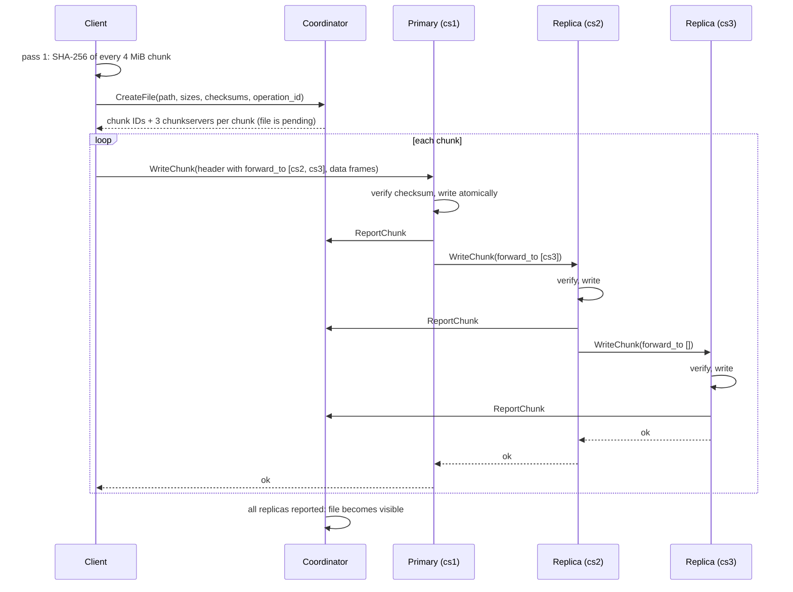

# gfs

A small GFS-inspired distributed file system in Go: one coordinator holds the metadata, four chunkservers store 3-way replicated chunks, and the cluster notices dead nodes and re-replicates their chunks on its own.

## Highlights

- Files are split into 4 MiB chunks, each with a SHA-256 checksum recorded by the coordinator at upload time.
- Every chunk is written to 3 chunkservers through a forwarding chain (client → primary → replica → replica).
- A file only becomes visible once every replica of every chunk has been stored and reported.
- Downloads verify every chunk against the coordinator's recorded checksum and fall back to another replica on failure.
- Chunkservers send heartbeats every second; the coordinator marks silent nodes Suspect, then Unavailable.
- New chunks are only placed on Healthy nodes, and reads try Healthy replicas first.
- A repair loop copies chunks that lost a replica to a healthy node, at most 4 copies at a time.
- Runs as a Docker Compose cluster (1 coordinator + 4 chunkservers, one volume each). Every RPC is logged as one JSON line (successful heartbeats at debug level, so they're hidden by default).

## Architecture



The coordinator only handles **metadata**: which files exist, which chunks they consist of, where each chunk's replicas live, and which nodes are alive. Chunk bytes never pass through it; the client streams them directly to and from chunkservers, and chunkservers copy them between each other during repair. Keeping the two planes apart means the coordinator's work per request is small and doesn't grow with file size, and a large transfer can't block metadata operations. (The diagram shows one example route per RPC; any chunkserver can be the primary, a reader's target, or a repair source or destination.)

## How it works

### Upload

1. **Checksum pass.** The client reads the file once, in 4 MiB chunks, and computes each chunk's length and SHA-256.
2. **CreateFile.** The client sends the path, sizes and checksums (plus an operation ID). The coordinator assigns chunk IDs, picks 3 different Healthy chunkservers for each chunk (rotating the starting node, so primaries spread out), records the checksums, and registers the file as *pending*.
3. **WriteChunk.** The client reads the file again and streams each chunk in 64 KiB frames to that chunk's first chunkserver, with the other two in `forward_to`. Each server verifies the checksum, writes the chunk atomically, reports it to the coordinator (`ReportChunk`), and forwards it to the next server. It acknowledges only after everyone after it in the chain has stored it, so a successful write means all 3 copies exist.
4. **Visible.** The coordinator checks every reported checksum against the one recorded in step 2. Once every replica of every chunk has been reported, the file becomes visible: it appears in `ls` and can be downloaded. Until then it stays pending, and a new upload to the same path replaces it.



### Download

1. **GetFileMetadata** returns the file's chunks in order, each with its replica addresses and the checksum recorded at upload. Replicas are ordered by node health: Healthy first, then nodes the coordinator hasn't heard from, then Suspect, then Unavailable last.
2. **ReadChunk.** For each chunk, the client tries the replicas in that order, moving on to the next one if a server fails or returns bad data.
3. **Verify.** Each chunk is checked against the coordinator's recorded checksum, never one reported by a chunkserver. The output is written to a temp file, synced, and renamed into place, so a failed download never leaves a partial file under the target name.

### Failure detection

Each chunkserver sends a `Heartbeat` (node ID, address, chunk count, bytes used) every second, with a 2 s deadline per call. The coordinator's registry keeps the time each node was last heard from, and a sweeper re-checks every node every 500 ms:

| Silent for | State |
|---|---|
| < 2 s | Healthy |
| ≥ 2 s | Suspect |
| ≥ 3 s | Unavailable |

A single heartbeat moves a node straight back to Healthy (logged as `node recovered`). New chunks are only placed on Healthy nodes; if no node is Healthy, `CreateFile` fails with `Unavailable`. Before any chunkserver has sent a heartbeat, placement uses the static `--chunkservers` list.

### Self-healing

Every 2 s the coordinator runs a repair round:

1. Take a snapshot of the Unavailable nodes. If there are none, stop; no RPCs are made.
2. `UnderReplicated` lists every chunk of a visible file with fewer than 3 copies outside the Unavailable set (chunks with no live copy are skipped: there's nothing to copy from).
3. For each chunk, pick a **source** (a live replica on a Healthy node) and a **destination** (a Healthy node that isn't, and never was, assigned the chunk, chosen from a random starting point so repairs spread out).
4. Send `CopyChunk` to the destination. It pulls the chunk from the source with `ReadChunk`, checks the length and checksum against the values the coordinator recorded, writes it atomically, and reports it.
5. On success, `AddReplica` records the destination in the chunk's metadata, so the next round no longer lists it.

At most 4 repairs run at once: a buffered channel acts as a semaphore, and a `sync.WaitGroup` waits for the whole round. Each `CopyChunk` has a 30 s deadline. A chunk that can't be repaired this round (no healthy source or destination, or a failed copy) is retried in the next one.

## Quick start

Requires Docker with Compose v2.

```
docker compose up -d --build                 # build the image, start coordinator + cs1..cs4
docker compose run --rm gfs upload /transfer/report.pdf
docker compose run --rm gfs ls
docker compose run --rm gfs download report.pdf /transfer/report-copy.pdf
docker compose run --rm gfs rm report.pdf
docker compose down -v                       # stop and delete all stored data
```

The CLI runs as a one-off container on the cluster network. Files go in and out through `./transfer` on the host, mounted at `/transfer` in the container.

## Demo: kill a node and watch it heal

Start a clean cluster and, in a **second terminal**, follow the coordinator's log:

```
docker compose down -v
docker compose up -d --build
docker compose logs -f coordinator
```

Create a 20 MB random file and upload it (PowerShell):

```powershell
$b = New-Object byte[] (20MB); (New-Object Random).NextBytes($b)
[IO.File]::WriteAllBytes("$PWD\transfer\test.bin", $b)
docker compose run --rm gfs upload /transfer/test.bin
```

On Linux/macOS: `head -c 20M /dev/urandom > transfer/test.bin`, then the same `upload` command.

Stop one chunkserver:

```
docker compose stop cs2
```

Within a few seconds the coordinator log shows cs2 going `suspect`, then `unavailable` (`node state changed`), then one `chunk re-replicated` line per chunk that had a copy on cs2, and a `repair round finished` line with the count. Every chunk now has 3 live copies again, on cs1, cs3 and cs4.

Stop a second chunkserver and download:

```
docker compose stop cs3
docker compose run --rm gfs download test.bin /transfer/out.bin
```

Only cs1 and cs4 are left, and every chunk is already on both, so there's no healthy node to copy to and the repairer has nothing to do. The download still succeeds from the two remaining copies. Compare hashes:

```powershell
(Get-FileHash transfer\test.bin).Hash -eq (Get-FileHash transfer\out.bin).Hash   # True
```

On Linux/macOS: `sha256sum transfer/test.bin transfer/out.bin`.

Bring the nodes back (the log shows `node recovered`) and clean up:

```
docker compose start cs2 cs3
docker compose down -v
```

## Design decisions

| Decision | Why | Trade-off |
|---|---|---|
| Separate metadata and data planes | The coordinator never handles chunk bytes, so its work per request stays small and doesn't grow with file size. | Two round trips per operation (coordinator, then chunkservers), and the client has to talk to many servers. |
| Chain replication (`forward_to`) | The client uploads each chunk once; servers pass it along, so the client's bandwidth isn't split three ways. | A write is as slow as the slowest server in the chain, and one dead server fails the whole write. |
| Files are invisible until every replica reports | A reader can never see a half-uploaded file or a chunk with fewer copies than promised. | An upload that dies midway leaves a pending file and orphan chunks behind. |
| Verify against the checksum recorded at upload, never one reported by a server | A corrupted or buggy chunkserver can't vouch for its own data; the coordinator's copy is the single source of truth. | The coordinator must keep a checksum for every chunk. |
| Atomic writes (temp file → fsync → rename) | A crash mid-write leaves either the old file or the new one, never a torn chunk or download. Rewriting the same chunk ID replaces it atomically, so retries are safe. | An fsync per chunk makes uploads slower. |
| Suspect before Unavailable | One late heartbeat (GC pause, network blip) shouldn't trigger repair; Suspect only stops new placements. A timeout means suspicion, not certainty. | Repair starts a little later: a node has to be silent for 3 s first. |
| Dead replicas are ordered last, not dropped | The coordinator's view can be wrong (e.g. a partition between it and a node), so a node it thinks is dead stays available as a last resort for readers. | When the earlier replicas fail, the client spends its last attempt on a node that is probably dead. |
| The repair destination pulls and verifies | The coordinator stays out of the data path, and the new copy is checked against the recorded checksum before it counts as a replica. | The destination must be able to reach the source directly. |
| Snapshot sets instead of nested locks | A repair round copies the Unavailable and Healthy sets out of the registry, then queries metadata with that snapshot; the registry and metadata locks are never held together, and never during network I/O. | A round works from a view that may be a moment out of date; anything it misses is caught next round. |
| Idempotent `CreateFile`, `AddReplica` and chunk delete | Clients and the repair loop can retry after a timeout without making things worse: the same `operation_id` returns the same plan, adding an existing replica is a no-op, and deleting a missing chunk succeeds. | The coordinator keeps operation IDs (currently never expired). |

## Testing

```
go test ./...
go test -race ./...      # needs cgo (a C compiler on Windows)
```

The tests run without Docker or the network. gRPC runs over in-memory `bufconn` listeners, and liveness tests use fake times instead of sleeping.

- **`internal/chunkserver`:** atomic store round trips and chunk-ID validation; `WriteChunk` checksum and length checks, forwarding to replicas, and failure when a replica in the chain is down; `ReadChunk` framing; `CopyChunk` copying between two in-memory servers, rejecting a wrong checksum (`DataLoss`) or a missing source (`Unavailable`) without storing anything; reporting to a fake coordinator; heartbeats (sent immediately, repeated with a deadline, surviving coordinator errors, stopping on cancel).
- **`internal/coordinator`:**
  - **Metadata:** file creation and `operation_id` idempotence, visibility rules, deletes, deep copies (mutating a returned value never changes stored state), and concurrent access under `-race`.
  - **Node registry:** the Healthy → Suspect → Unavailable state machine driven by fake clocks.
  - **Placement:** never on a dead node.
  - **Read ordering:** Unavailable replicas returned last, with healthy ones in their original order.
  - **Repair:** `UnderReplicated` and `AddReplica` cases, and an end-to-end repair over 4 in-memory chunkservers where one is marked Unavailable. `RunOnce` must copy every affected chunk to a node that didn't have it, with identical bytes, and leave nothing under-replicated. It must make no calls when nothing is down, and `Run` must stop on cancel.
- **`internal/client`:** upload/download round trip through a coordinator and chunkservers; detecting a corrupted chunk; failed uploads not listed; delete; a replicated upload that is still readable after a node is lost.

## Performance

Measured detection and repair times: coming soon (see docs)

## Known limitations / future work

- **In-memory metadata:** the coordinator's namespace and chunk map are lost when it restarts.
- **Single coordinator:** no failover or consensus; if it's down, nothing can be uploaded, listed or downloaded.
- **Over-replication isn't cleaned up:** when a node comes back after its chunks were re-replicated, those chunks have an extra copy that's never garbage-collected.
- **Orphan chunks:** chunks left behind by failed deletes or abandoned uploads are not garbage-collected.
- **Whole-operation CLI timeout:** the CLI has one 60 s timeout for the entire operation, so very large files fail; it should be per chunk.
- **Sequential uploads:** chunks are uploaded one at a time.
- **No auth or TLS:** all gRPC traffic is plaintext and unauthenticated.

## Layout

```
cmd/coordinator      coordinator binary (metadata, node registry, repair loop)
cmd/chunkserver      chunkserver binary (chunk bytes, heartbeats)
cmd/gfs              CLI client: upload, download, ls, rm
internal/coordinator metadata.go, nodes.go (registry), repair.go, server.go (gRPC)
internal/chunkserver store.go (atomic chunk files), server.go, heartbeat.go
internal/client      upload/download logic used by the CLI
internal/grpclog     request-logging interceptors
proto/               .proto contracts; generated Go code in proto/gfspb
docs/                design documents (PRD.md)
```

## Prerequisites

- Go 1.27+
- Docker with Compose v2, for the cluster
- `protoc` (Protocol Buffers compiler), only needed to regenerate code
- `protoc-gen-go` and `protoc-gen-go-grpc`, only needed to regenerate code:
  ```
  go install google.golang.org/protobuf/cmd/protoc-gen-go@latest
  go install google.golang.org/grpc/cmd/protoc-gen-go-grpc@latest
  ```

## Build

Generated code is committed, so a plain build needs only Go:

```
go build ./...
```

With `make` (Linux/macOS, or Windows with GNU make):

```
make proto   # regenerate proto/gfspb from proto/*.proto
make build   # compile everything and write binaries to bin/
make test
make clean
```

On Windows without `make`, use the PowerShell script with the same targets:

```
.\make.ps1 proto
.\make.ps1 build
.\make.ps1 test
```

## Running with Docker

The cluster is one coordinator and four chunkservers (`cs1`–`cs4`), each chunkserver with its own named volume. The coordinator also gets the static list `cs1:7001,...,cs4:7001`, used for placement until the first heartbeat arrives.

```
docker compose build          # build the image (all three binaries)
docker compose up -d          # start coordinator + cs1..cs4 in the background
```

Client commands are the ones in [Quick start](#quick-start). Watch the logs (one JSON line per RPC, except successful heartbeats, plus node state changes and repairs):

```
docker compose logs -f              # everything
docker compose logs -f coordinator  # just the coordinator
```

Simulate a node failure and restore it:

```
docker compose stop cs2
docker compose run --rm gfs download report.pdf /transfer/copy-while-cs2-down.pdf
docker compose start cs2
```

Stop everything and delete all stored data:

```
docker compose down -v
```
